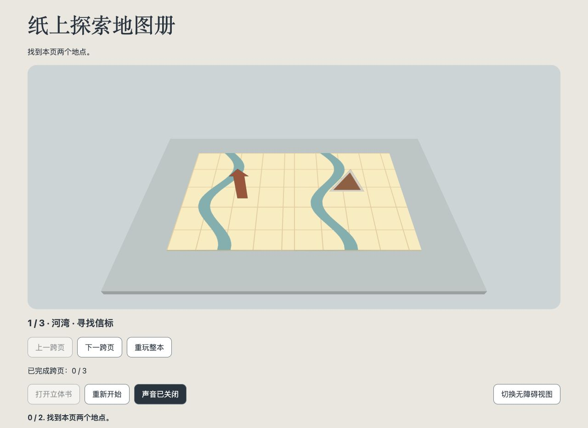

# 照片变互动立体地图册 Skill

把照片、录音和故事做成能翻页、能探索、能完成任务的纸片立体书。

## 选择版本

| 版本 | 使用方式 | 下载 |
|---|---|---|
| Dots | 一次集中收集背景，由助手负责素材、制作、验证与交付 | [下载 Dots Skill](downloads/build-photo-pop-up-game-dots-v1.2.zip) |
| Codex | 分轮确认关键选择，支持预算与 Goal 工作流 | [下载 Codex Skill](downloads/build-photo-pop-up-game-codex-v1.2.zip) |

解压对应 ZIP，通过客户端支持的 Skill 入口导入；也可以让助手先读取文件夹里的 `SKILL.md`。

> 请用这个 Skill，把我的照片和录音做成可玩的地图册立体书。先确认用途和素材，其余细节合理默认，交付离线 HTML、源码和验证报告。

## 试玩与配置

下载后打开 `examples/atlas.html`，即可体验三组跨页、六个地点的地图册；`examples/demo.html` 是单跨页示例。

- 连续前后翻页、纸片立起、地点说明及音频。
- 收集与顺序路线任务、跨页进度、单页与整本重玩。
- 键盘操作、减少动画与保留图片线索的无障碍视图。
- 用 `maps.left/right` 配置地图底图，用 `pieces` 配置图片、位置、尺寸与音频。

配置指南：[地图册](build-photo-pop-up-game-dots/references/atlas.md) · [离线构建](build-photo-pop-up-game-dots/references/starter.md)

## 素材制作

助手负责查看参考照片、调用可用的图片生成或编辑工具、检查纸片素材、整理音频并完成游戏。离线构建器将准备好的素材嵌入 HTML。演示使用程序地图、透明信标与合成音。

## 验证

两版各 20 项 Python 测试和 Node 状态/界面测试通过，并检查了实际浏览器中的翻页、任务、重玩、音频状态、390px 窄屏和无障碍视图。详细记录见 [验证报告](build-photo-pop-up-game-dots/references/validation.md)。

## 依赖

Three.js MIT 许可随包保留于 `assets/starter/vendor/THREE-LICENSE.txt`。项目素材沿用各自授权。
